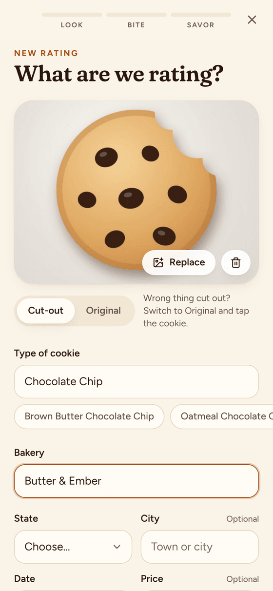
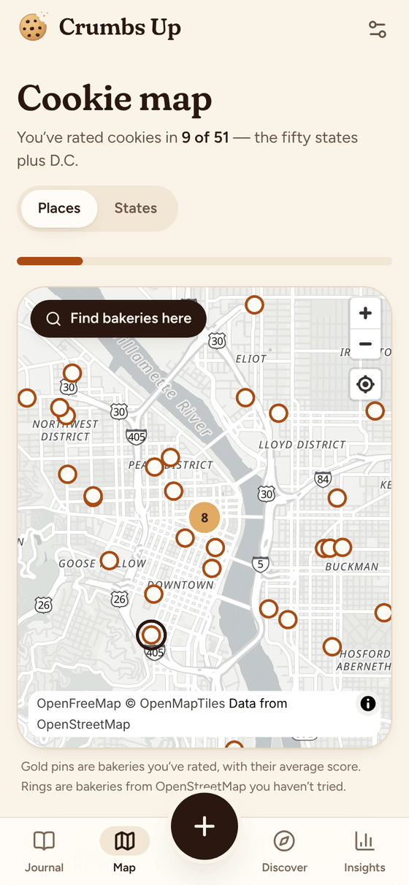
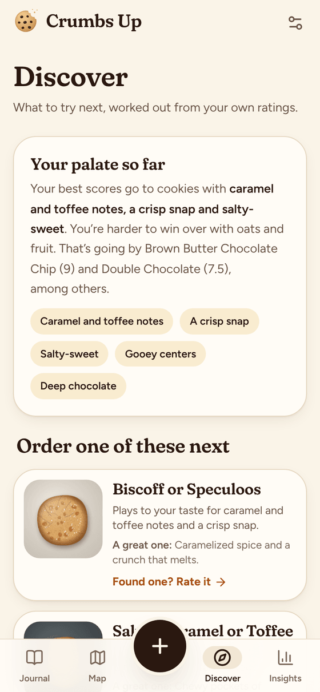

# Crumbs Up

**A guided cookie-rating journal for your phone and the web.**

Buy a cookie, take its photo, and give it a number from 1 to 10 for how it looks, eats and
tastes. Every number comes with words saying what it means, and **5 is an average cookie**: good,
nothing special. For more detail there is a full tasting: five worded questions per category,
from which Crumbs Up works out the score.

<p>
  
  
  
  
</p>

## What it does

- **Guided rating.** One question per screen, answered with a tap. The questions follow the order
  you actually meet a cookie — _look, bite, savor_ — and each category ends with a suggested score,
  the reasoning behind it, and a nudge control if your gut disagrees.
- **Every cookie on record.** Type of cookie, bakery, city, state, date, price, photo and tasting
  notes. Past bakeries and cookie types are offered as one-tap suggestions.
- **Photos that look like a collection.** Take a snapshot and the app finds the cookie, lifts it
  off whatever it was sitting on, and sets it on a clean tabletop — so every cookie in the journal
  is framed the same way. If it grabs the wrong thing, tap the cookie yourself. The original photo
  is always kept and is one tap away.
- **No photo? It draws one.** A cookie without a photo gets an illustration built from its review:
  the type decides the recipe (chips, oats, cinnamon sugar, dark dough…), and your answers decide
  the specimen — how generous the mix-ins are, how even the bake, whether it spread, burned or
  broke.
- **Journal.** A photo grid you can search, filter by state, and flip between _recent_ and
  _ranked_. The best cookie you've had sits at the top as the reigning champion.
- **Cookie map.** A street map with a pin for every bakery you've rated (each showing its average
  score), and a second view shading the U.S. by how good each state's cookies have been, with a
  count of how many of the 50 states + D.C. you've covered. Tap **Find bakeries here** to see
  bakeries in that neighborhood you haven't tried yet.
- **Discover.** Recommendations worked out from your own ratings: the app reads what your best and
  worst cookies have in common ("caramel and toffee notes, a good chew — not so much sprinkles"),
  then suggests kinds you haven't tried that play to that, kinds worth a second chance, bakeries
  worth a return trip, and neighboring states you haven't logged a cookie in.
- **Places without the typing.** One tap fills in the town from your phone's location and keeps the
  exact spot for the map. Typing a bakery's name offers matching places to pin; typing a town
  offers suggestions and sets the state.
- **Insights.** Averages by category, score distribution, cookie-by-cookie trend, top bakeries and
  cookie types, and a hall of fame (_best tasting_, _ugly delicious_, _all show_…). A **You vs. the
  questions** card shows how often, and in which direction, you overrule the suggested scores — so
  if the questions run hot or cold for your taste in one category, it shows up and can be tuned.
- **Shareable scorecards.** One tap turns a cookie into a 4:5 image for Instagram or a group chat.
- **Quick entry.** Already scored a cookie in an old notebook? Skip the questions and type the
  three numbers in.
- **Works like an app.** Installs to the home screen, runs offline, keeps drafts if you get
  interrupted mid-cookie, and has a dark "midnight snack" theme.
- **Sign in, or don't.** Without an account everything stays on the device. Sign in and the
  journal — photos included — is backed up and kept in step between your phone and your computer,
  private to you. It still works offline; changes are sent when the connection comes back.
- **Your data stays yours.** One button makes a `.zip` backup (photos included, plus a
  spreadsheet-friendly CSV); another restores it on any device, account or no account.

<p>
  
  
  
  
</p>

## How the scoring works

The full rule book is in the app under **Settings → How the scoring works**, and it is generated
from the same data the questionnaire uses, so it can't drift.

**The quick review** (the default) asks for one number per category. Each number from 1 to 10 has
a name ("Average", "Excellent"…) and a line saying what it means for that category, so the same
cookie gets the same score whoever rates it. The **full tasting** works like this:

1. **Each category asks five questions** (plus a quick "anything off?" flaw check). Texture first
   asks what style the cookie is going for — chewy, crisp, cakey… — so a shortbread isn't marked
   down for not being gooey.
2. **Answers are worded, never numbered.** Every question has six rungs: two below average,
   average itself, and three above it. Behind the words the rungs are worth
   `1.5 · 3.5 · 5 · 6.5 · 8 · 10`.
3. **The category score is the weighted average** of those rungs (first impressions, being true to
   style, and flavor depth count the most). "Doesn't apply" answers drop out.
4. **Flagged flaws subtract** half a point or a point each, capped at 2 per category.
5. **It's rounded to the half point** and kept between 1 and 10.
6. **You get the last word.** The suggestion can be nudged; the journal remembers both numbers.

The **overall** score combines the three categories. The default counts how it eats most: 40%
taste, 40% texture, 20% appearance. Settings also offers equal thirds, the classic baking-contest
split (40/30/30) and a taste-first split (50/30/20). Changing it re-ranks the whole journal, and
the overall in Top rated, without touching category scores. The journal and Top rated can also be
ranked by taste, texture or appearance alone.

The questions were shaped by how cookies are actually judged — fair and 4-H score sheets, sensory
evaluation practice (fully-worded scales, judging texture as
"characteristic of type"), and food-science writing on what separates a great cookie from a fine
one. The rubric lives in [`src/lib/rubric/questions.ts`](src/lib/rubric/questions.ts) and is meant
to be edited: change a prompt, a weight or a penalty there and the wizard, the guide and the tests
all follow.

## How the photo cut-out works

The cut-out runs **entirely on the device** — finding the cookie never sends the photo anywhere.

- It uses two of Google's open-source [MediaPipe](https://ai.google.dev/edge/mediapipe) models.
  A small object detector says roughly where things are; the
  [Interactive Segmenter](https://ai.google.dev/edge/mediapipe/solutions/vision/interactive_segmenter),
  given a point on something, returns that thing's exact outline.
- **Finding the cookie.** People rarely put it in the middle — it is held out in one hand, or sits
  low in the frame with the bakery behind it. The detector was never taught the word "cookie",
  but it reliably files one under _donut_, _cake_ or _sandwich_, which is enough to know where to
  look. If it sees nothing of the kind, the app tries the most cookie-coloured spot, then the
  place a cookie held in the left hand usually ends up.
- **Checking it is one.** Each candidate is judged before it is used: a cookie is one solid shape
  inside the frame. A floor wrapping around furniture, a wrapper with a cookie-shaped hole in it
  (the cookie is then looked for _in_ the hole), a white label, or a person holding the cookie are
  all turned down. If nothing convincing turns up within three looks, the photo is left as it was
  — an honest photo beats a neatly cut-out piece of table — and you can tap the cookie yourself.
- The outline is cleaned up (one shape only, chocolate-chip-sized holes filled), then the cookie
  is placed on a tabletop with a soft shadow.
- The first use downloads the models and their runtime (about 42 MB in total) and stores them in
  the browser's cache; after that it works offline. The work happens in a background worker, so
  the form stays responsive while it thinks.
- If the download fails, nothing can be found, or the browser can't run it, the photo is simply
  used as it is. The feature can be switched off in Settings, and it does not start by itself for
  people who have asked their browser to save data.

By default the model files are fetched from Google's public model bucket. To host them yourself,
set `VITE_COOKIE_FINDER_MODEL_URL` (for `interactive_segmentation.task`) and
`VITE_COOKIE_SPOTTER_MODEL_URL` (for `efficientdet_lite2.tflite`) at build time.

## Maps, places and recommendations

**Recommendations are computed on the device** from your own journal — nothing is sent anywhere to
produce them, and nobody else's data is involved. Each kind of cookie the app knows (about 35 of
them) carries a few traits: chocolate, caramel, spice, citrus, chewy, crisp and so on. The app works
out which traits score above and below your average, pulling small samples toward zero so one great
cookie doesn't define your palate, and ranks untried kinds by how well they fit. If the
questionnaire recorded how a cookie actually ate (chewy, crisp…), that beats what its kind usually
eats like. The knowledge base is one file — [`src/lib/cookie-kinds.ts`](src/lib/cookie-kinds.ts) —
and easy to extend.

**Putting bakeries on the map works offline.** The app bundles about 16,000 U.S. cities and towns
with coordinates, so city suggestions, "use my location" (which finds the nearest town) and
placing a bakery by its town all work with no connection and without sending your whereabouts
anywhere. A bakery pinned from your location or picked from the map sits at its exact spot; one
known only by town sits near the town's center.

**Three things here do go online**, and none of them carries your ratings:

| What                     | Service                                            | What is sent                       |
| ------------------------ | -------------------------------------------------- | ---------------------------------- |
| The street map's tiles   | [OpenFreeMap](https://openfreemap.org)             | The area of the map you're viewing |
| Finding a bakery by name | [Photon](https://photon.komoot.io) (OpenStreetMap) | The name typed, and a nearby point |
| "Find bakeries here"     | Photon                                             | The center of the map              |

The two lookups can be switched off in Settings. The States view of the map never goes online.

Both services are free, need no account and are run for the public good, which suits a personal
app. If Crumbs Up grows a real audience, plan to host tiles and search yourself or move to a paid
provider — the calls are isolated in [`src/lib/osm.ts`](src/lib/osm.ts) and
[`src/features/map/PlacesMap.tsx`](src/features/map/PlacesMap.tsx).

Credits: map data © [OpenStreetMap](https://www.openstreetmap.org/copyright) contributors (ODbL);
map tiles by OpenFreeMap / [OpenMapTiles](https://openmaptiles.org); town list from
[GeoNames](https://www.geonames.org) (CC BY 4.0), rebuilt with `node scripts/build-places.mjs`.

## Use it on your phone

Crumbs Up is a Progressive Web App: the website _is_ the phone app.

- **iPhone / iPad:** open the site in Safari → Share → **Add to Home Screen**.
- **Android:** open the site in Chrome → **Install app** (the app also offers a button).

Installing matters for more than convenience. Safari clears a website's saved data after about a
week without a visit, but not an installed app's — and without an account the journal lives only
on the device. Signing in (the **Sign in** button at the top) keeps a copy safe in your account; otherwise use
**Settings → Back up journal** now and then. The app reminds you after every few cookies.

## Run it locally

Requires Node 20.19 or newer.

```bash
npm install
npm run dev        # http://localhost:5173
```

| Command             | What it does                                          |
| ------------------- | ----------------------------------------------------- |
| `npm run dev`       | Start the dev server with hot reload                  |
| `npm run build`     | Type-check and build the production app into `dist/`  |
| `npm run preview`   | Serve the production build locally                    |
| `npm test`          | Unit tests (scoring engine, backup format, sync…)     |
| `npm run test:e2e`  | End-to-end tests in a phone-sized browser (see below) |
| `npm run lint`      | Lint with oxlint                                      |
| `npm run typecheck` | Type-check only                                       |
| `npm run format`    | Format with Prettier                                  |
| `npm run icons`     | Regenerate app icons from `public/logo.svg`           |

The end-to-end tests need a browser once: `npx playwright install chromium`.

Run like this, the app has no accounts — it is the device-only journal. To work on sign-in and
sync, see [Accounts and sync](#accounts-and-sync).

## Put it online

The build is a folder of static files, so any static host works.

**GitHub Pages (included).** [`deploy.yml`](.github/workflows/deploy.yml) builds and publishes the
site on every push to `main`. Turn it on once under **Settings → Pages → Build and deployment →
Source: GitHub Actions**. The site appears at `https://<user>.github.io/<repo>/`; the workflow
works out the sub-path by itself. (GitHub Pages on a private repository needs a paid plan.)

**Netlify, Cloudflare Pages, Vercel and friends.** Connect the repository, set the build command
to `npm run build` and the output folder to `dist`. `public/_redirects` already tells Netlify and
Cloudflare to serve the app for every path; on other hosts, add their equivalent single-page-app
rewrite to `index.html`.

To serve from a sub-folder, build with `BASE_PATH=/your/path/ npm run build`.

## Accounts and sync

Accounts are optional and off until the app is built with a [Supabase](https://supabase.com)
project's address. Supabase supplies the three things sync needs — sign-in, a database and file
storage — and its free plan is plenty for a personal journal.

**What signing in does.** The journal on the device stays the real one: every screen reads and
writes it directly, so the app is exactly as fast, and works exactly as well offline, as it does
without an account. Signing in adds a copy in your account and keeps the two in step.

- Cookies rated before signing in come along the first time you do.
- Every change is noted in a small queue on the device and sent when there's a connection —
  straight away if there is one, later if there isn't.
- If the same cookie was edited on two devices, the more recent edit wins, cookie by cookie.
  Deleting a cookie deletes it everywhere.
- Photos (the picture and, for a cut-out, the original behind it) go to private storage that only
  your account can read.
- An account can be deleted from its Account page, with everything kept in it, at any time.
- Signing out asks whether to keep the journal on the device or take it off. Taking it off is
  refused while the device holds cookies the account hasn't received. A device that holds one
  account's journal won't quietly merge it into another: signing in as someone else asks first.
- Sample cookies never leave the device.

**Setting it up**

1. Create a project at [supabase.com](https://supabase.com) (the free plan will do).
2. Open the project's **SQL Editor** and run each file in
   [`supabase/migrations`](supabase/migrations), in name order: paste one in, run it, then the
   next. Together they create the one table, the private photo storage, the rules that keep each
   person's journal to themselves, the means for someone to delete their own account, and the
   totals behind **Top rated** (everyone's scores added up per cookie, with nothing in them to
   say whose they were). Every file is safe to run twice.
3. Under **Authentication → URL Configuration**, set the **Site URL** to where the app lives
   (for example `https://<user>.github.io/<repo>/`) and add that address followed by `**` to the
   **Redirect URLs**, plus `http://localhost:5173/**` for development.
4. Give the app the project's **URL** and **publishable key** (Project Settings → API keys) as
   `VITE_SUPABASE_URL` and `VITE_SUPABASE_PUBLISHABLE_KEY` — in `.env.local` for development and
   [`.env.production`](.env.production) for the published build. See
   [`.env.example`](.env.example). (This repository's `.env.production` points at its own live
   project; a fork should replace both values with its own.)

Both of those values are public by design: they end up in the app's code, where anyone can read
them, and the database rules are what protect the data. **The secret key (`sb_secret_…`) and the
database password must never go into the app or this repository.**

**Sign in with Google or Apple.** Switch the provider on under **Authentication → Sign In /
Providers** in Supabase (each needs credentials from Google's or Apple's developer console — the
Supabase page for the provider lists the steps). That is all: the app asks the project which
providers are on, so the "Continue with Apple" and "Continue with Google" buttons appear by
themselves the next time it is opened, with no new build.

**The emails carry a code, not a link.** "Create account" and "Forgot password?" each open a page
of their own, and both finish by typing a short code from an email into the app. A code works whichever device the email
is read on, and an email with nothing to click is far less likely to be held as phishing by a
school's or workplace's mail filter. The app expects it, so the project has to send it: under
**Authentication → Emails → Templates**, give "Confirm signup" and "Reset password" the subject
`{{ .Token }} is your Crumbs Up code` and the bodies in
[`supabase/templates/`](supabase/templates). (The local stack picks both up from
`supabase/config.toml` by itself.)

**Things to know about the free plan**

- New accounts confirm their email address by default, and Supabase's built-in mail service is
  only for trying things out: it delivers to the project's own team members and nobody else, and
  sends about two messages an hour. That is fine for your own account. Before inviting other
  people, connect a mail service under **Authentication → Emails → SMTP Settings** — or have them
  sign in with Google, which needs no email at all.
- A project with no activity for a week is paused until you resume it from the dashboard. Nothing
  is lost, and the app keeps working from the device in the meantime.

**Working on it locally.** The [Supabase CLI](https://supabase.com/docs/guides/local-development)
runs the whole backend on your machine (it needs Docker):

```bash
npx supabase start        # database, sign-in and storage, with the migration applied
npm run dev:cloud         # the app, pointed at the local stack
npm run test:cloud        # sync against a real database: privacy rules, conflicts, photos
npm run test:e2e:cloud    # two "devices" sharing an account, in a real browser
```

Emails the local stack "sends" (the codes for confirming an account and resetting a password)
are caught in an inbox at `http://127.0.0.1:24324`.

CI runs the same two suites on every pull request, in a job of their own.

## How it's built

| Concern           | Choice                                                                                                                                      |
| ----------------- | ------------------------------------------------------------------------------------------------------------------------------------------- |
| App               | [React](https://react.dev) 19 + [TypeScript](https://www.typescriptlang.org), built with [Vite](https://vite.dev)                           |
| Routing           | [React Router](https://reactrouter.com)                                                                                                     |
| Styling           | [Tailwind CSS](https://tailwindcss.com) 4 with a small set of design tokens                                                                 |
| Type              | [Fraunces](https://fonts.google.com/specimen/Fraunces) and [Figtree](https://fonts.google.com/specimen/Figtree), self-hosted via Fontsource |
| Storage           | IndexedDB through [Dexie](https://dexie.org); live queries keep every screen in sync                                                        |
| Offline / install | [vite-plugin-pwa](https://vite-pwa-org.netlify.app) (Workbox)                                                                               |
| Photos            | [Compressor.js](https://github.com/fengyuanchen/compressorjs) shrinks camera photos before saving                                           |
| Photo cut-outs    | [MediaPipe Tasks Vision](https://www.npmjs.com/package/@mediapipe/tasks-vision) — on-device segmentation in a web worker                    |
| Accounts and sync | [Supabase](https://supabase.com) — sign-in, Postgres with row-level security, private file storage (optional)                               |
| Backups           | [fflate](https://github.com/101arrowz/fflate) zips, validated on the way back in with [Zod](https://zod.dev)                                |
| Map               | [us-atlas](https://github.com/topojson/us-atlas) shapes drawn with [d3-geo](https://d3js.org/d3-geo)                                        |
| Street map        | [MapLibre GL JS](https://maplibre.org) with [OpenFreeMap](https://openfreemap.org) tiles                                                    |
| Place search      | [Photon](https://photon.komoot.io), built on OpenStreetMap                                                                                  |
| Charts            | [Recharts](https://recharts.org)                                                                                                            |
| Share images      | [modern-screenshot](https://github.com/qq15725/modern-screenshot)                                                                           |
| UI primitives     | [Radix UI](https://www.radix-ui.com) dialogs, [Sonner](https://sonner.emilkowal.ski) toasts, [Lucide](https://lucide.dev) icons             |
| Tests             | [Vitest](https://vitest.dev) and [Playwright](https://playwright.dev)                                                                       |

```
src/
  app/              shell, routing, error screens, update prompt
  components/       shared UI: buttons, score medallion and bars, sheets, fields
  features/
    journal/        the cookie grid, search, first-run welcome
    rate/           the rating wizard (details → questions → results → verdict)
    cookie/         a cookie's page and its shareable scorecard
    map/            street map of your bakeries, and the state map
    discover/       recommendations
    insights/       statistics and charts
    settings/       weighting, theme, backup and restore
    guide/          "how the scoring works", generated from the rubric
  lib/
    rubric/         questions, weights, the scoring engine and its tests
    cookie-kinds.ts what each kind of cookie tastes and eats like
    recommend.ts    reads a palate from the journal and suggests what to try
    places.ts       bundled U.S. towns: suggestions, nearest town, map positions
    osm.ts          bakery lookups in OpenStreetMap
    cutout/         finds the cookie in a photo and sets it on a tabletop
    cookie-art/     draws a cookie from its type and review
    db/             IndexedDB schema, cookie repository, backup format
    cloud/          accounts and the sync engine
    …               formatting, statistics, photo processing, settings
supabase/           the database migration and local-development config
e2e/                end-to-end tests
```

A few decisions worth knowing about:

- **Scores are derived, answers are stored.** Each cookie keeps its answers, the suggested score
  and the recorded score, along with the rubric version that produced them. The overall score is
  computed on the fly from the current weighting.
- **Photos are stored as raw bytes** in their own tables (a small thumbnail and a ~1600px
  picture), so lists never load full-size images. When the picture is a cut-out, the untouched
  photo is stored alongside it and travels in backups too.
- **Illustrations are drawn on demand, never stored.** They are a pure function of the cookie's
  type, answers and id, so they stay in step with the review and cost nothing in a backup.
- **Colors were checked, not eyeballed.** The three category colors are distinguishable under the
  common forms of color blindness and are never the only cue — every score has a label beside it.
- **Updates wait to be asked.** A new version is offered with an "Update" prompt rather than
  swapped in mid-rating.
- **The device is the source of truth; the account is a copy.** Sync is a small engine of its own
  ([`src/lib/cloud/sync.ts`](src/lib/cloud/sync.ts)) rather than a framework: an outbox of changes
  to send, a cursor for changes to fetch, and "the newer edit wins" enforced by the database
  itself, so a slow device can never overwrite a newer edit. It talks to the server through a
  six-method interface, which is how the tests run it against both an in-memory stand-in and a
  real Supabase.
- **Privacy is enforced by the database, not the app.** Row-level security limits every query and
  every stored photo to its owner, so the key shipped in the app can't read anyone else's journal.
  The tests sign in as two people and check that one can't see or change the other's.

## Where it could go next

- **Public pages.** With accounts in place, a shareable public page per cookie or per reviewer
  becomes a small step.
- **App Store and Google Play.** The same code can be wrapped with
  [Capacitor](https://capacitorjs.com) to ship through the stores, which needs Apple and Google
  developer accounts.
