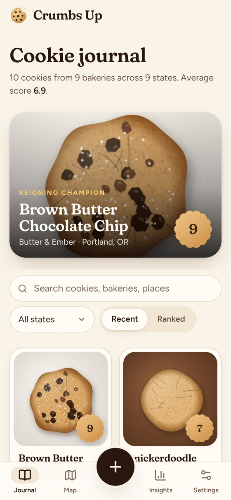
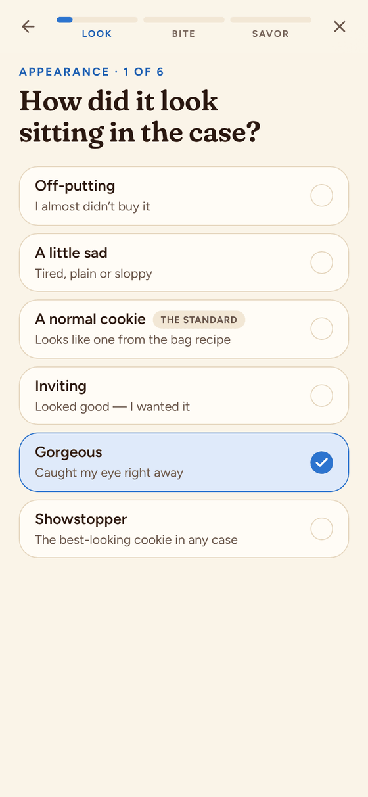
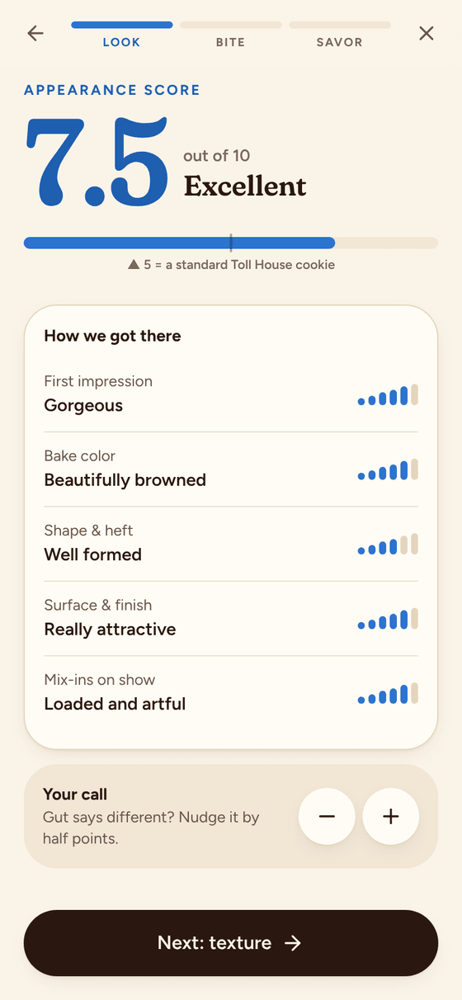
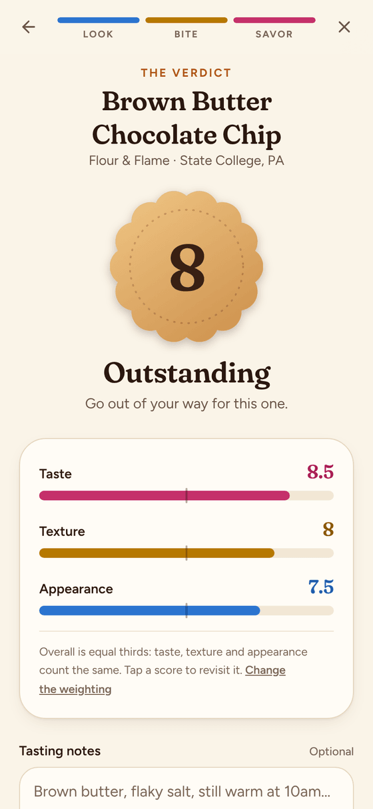
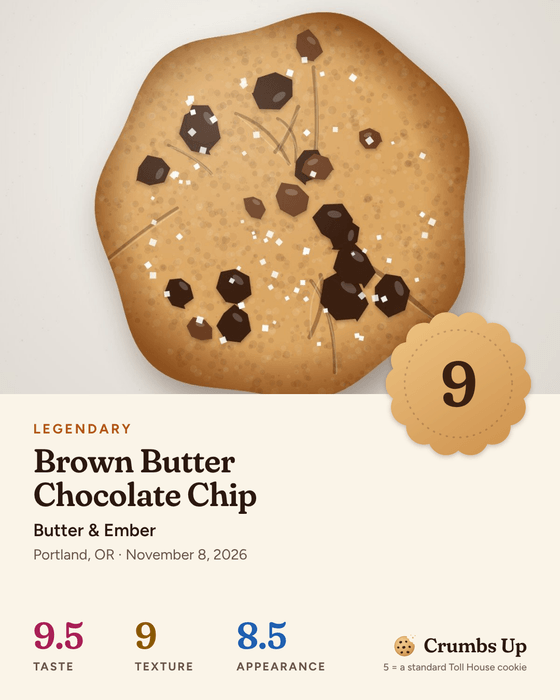

# Crumbs Up

**A guided cookie-rating journal for your phone and the web.**

Buy a cookie, take its photo, answer fifteen quick questions about how it looks, eats and tastes,
and Crumbs Up works out what it should score — in half points from 1 to 10, always measured
against one fixed reference: **a standard Toll House cookie is a 5.**

<p>
  
  
  
  
</p>

## What it does

- **Guided rating.** One question per screen, answered with a tap. The questions follow the order
  you actually meet a cookie — _look, bite, savor_ — and each category ends with a suggested score,
  the reasoning behind it, and a nudge control if your gut disagrees.
- **Every cookie on record.** Type of cookie, bakery, city, state, date, price, photo and tasting
  notes. Past bakeries and cookie types are offered as one-tap suggestions.
- **Journal.** A photo grid you can search, filter by state, and flip between _recent_ and
  _ranked_. The best cookie you've had sits at the top as the reigning champion.
- **Cookie map.** The U.S. shaded by how good each state's cookies have been, with a count of how
  many of the 50 states + D.C. you've covered.
- **Insights.** Averages by category, score distribution, cookie-by-cookie trend, top bakeries and
  cookie types, and a hall of fame (_best tasting_, _ugly delicious_, _all show_…).
- **Shareable scorecards.** One tap turns a cookie into a 4:5 image for Instagram or a group chat.
- **Quick entry.** Already scored a cookie in an old notebook? Skip the questions and type the
  three numbers in.
- **Works like an app.** Installs to the home screen, runs offline, keeps drafts if you get
  interrupted mid-cookie, and has a dark "midnight snack" theme.
- **Your data stays yours.** Everything is stored on the device. One button makes a `.zip` backup
  (photos included, plus a spreadsheet-friendly CSV); another restores it on any device.

<p>
  
  
</p>

## How the scoring works

The full rule book is in the app under **Settings → How the scoring works**, and it is generated
from the same data the questionnaire uses, so it can't drift. In short:

1. **Each category asks five questions** (plus a quick "anything off?" flaw check). Texture first
   asks what style the cookie is going for — chewy, crisp, cakey… — so a shortbread isn't marked
   down for not being gooey.
2. **Answers are worded, never numbered.** Every question has six rungs: two below the standard,
   the standard itself, and three above it. Behind the words the rungs are worth
   `1.5 · 3.5 · 5 · 6.5 · 8 · 10`.
3. **The category score is the weighted average** of those rungs (first impressions, being true to
   style, and flavor depth count the most). "Doesn't apply" answers drop out.
4. **Flagged flaws subtract** half a point or a point each, capped at 2 per category.
5. **It's rounded to the half point** and kept between 1 and 10.
6. **You get the last word.** The suggestion can be nudged; the journal remembers both numbers.

The **overall** score combines the three categories. The default is a plain average ("equal
thirds"); Settings also offers the classic baking-contest split (40/30/30) and a taste-first split
(50/30/20). Changing it re-ranks the whole journal instantly without touching category scores.

The questions were shaped by how cookies are actually judged — fair and 4-H score sheets, sensory
evaluation practice (fully-worded scales, anchoring to a reference sample, judging texture as
"characteristic of type"), and food-science writing on what separates a great cookie from a fine
one. The rubric lives in [`src/lib/rubric/questions.ts`](src/lib/rubric/questions.ts) and is meant
to be edited: change a prompt, a weight or a penalty there and the wizard, the guide and the tests
all follow.

## Use it on your phone

Crumbs Up is a Progressive Web App: the website _is_ the phone app.

- **iPhone / iPad:** open the site in Safari → Share → **Add to Home Screen**.
- **Android:** open the site in Chrome → **Install app** (the app also offers a button).

Installing matters for more than convenience. Safari clears a website's saved data after about a
week without a visit, but not an installed app's — and the journal lives on the device. Either way,
use **Settings → Back up journal** now and then; the app reminds you after every few cookies.

## Run it locally

Requires Node 20.19 or newer.

```bash
npm install
npm run dev        # http://localhost:5173
```

| Command             | What it does                                          |
| ------------------- | ----------------------------------------------------- |
| `npm run dev`       | Start the dev server with hot reload                  |
| `npm run build`     | Type-check and build the production app into `dist/`  |
| `npm run preview`   | Serve the production build locally                    |
| `npm test`          | Unit tests (scoring engine, backup format)            |
| `npm run test:e2e`  | End-to-end tests in a phone-sized browser (see below) |
| `npm run lint`      | Lint with oxlint                                      |
| `npm run typecheck` | Type-check only                                       |
| `npm run format`    | Format with Prettier                                  |
| `npm run icons`     | Regenerate app icons from `public/logo.svg`           |

The end-to-end tests need a browser once: `npx playwright install chromium`.

## Put it online

The build is a folder of static files, so any static host works.

**GitHub Pages (included).** [`deploy.yml`](.github/workflows/deploy.yml) builds and publishes the
site on every push to `main`. Turn it on once under **Settings → Pages → Build and deployment →
Source: GitHub Actions**. The site appears at `https://<user>.github.io/<repo>/`; the workflow
works out the sub-path by itself. (GitHub Pages on a private repository needs a paid plan.)

**Netlify, Cloudflare Pages, Vercel and friends.** Connect the repository, set the build command
to `npm run build` and the output folder to `dist`. `public/_redirects` already tells Netlify and
Cloudflare to serve the app for every path; on other hosts, add their equivalent single-page-app
rewrite to `index.html`.

To serve from a sub-folder, build with `BASE_PATH=/your/path/ npm run build`.

## How it's built

| Concern           | Choice                                                                                                                                      |
| ----------------- | ------------------------------------------------------------------------------------------------------------------------------------------- |
| App               | [React](https://react.dev) 19 + [TypeScript](https://www.typescriptlang.org), built with [Vite](https://vite.dev)                           |
| Routing           | [React Router](https://reactrouter.com)                                                                                                     |
| Styling           | [Tailwind CSS](https://tailwindcss.com) 4 with a small set of design tokens                                                                 |
| Type              | [Fraunces](https://fonts.google.com/specimen/Fraunces) and [Figtree](https://fonts.google.com/specimen/Figtree), self-hosted via Fontsource |
| Storage           | IndexedDB through [Dexie](https://dexie.org); live queries keep every screen in sync                                                        |
| Offline / install | [vite-plugin-pwa](https://vite-pwa-org.netlify.app) (Workbox)                                                                               |
| Photos            | [Compressor.js](https://github.com/fengyuanchen/compressorjs) shrinks camera photos before saving                                           |
| Backups           | [fflate](https://github.com/101arrowz/fflate) zips, validated on the way back in with [Zod](https://zod.dev)                                |
| Map               | [us-atlas](https://github.com/topojson/us-atlas) shapes drawn with [d3-geo](https://d3js.org/d3-geo)                                        |
| Charts            | [Recharts](https://recharts.org)                                                                                                            |
| Share images      | [modern-screenshot](https://github.com/qq15725/modern-screenshot)                                                                           |
| UI primitives     | [Radix UI](https://www.radix-ui.com) dialogs, [Sonner](https://sonner.emilkowal.ski) toasts, [Lucide](https://lucide.dev) icons             |
| Tests             | [Vitest](https://vitest.dev) and [Playwright](https://playwright.dev)                                                                       |

```
src/
  app/              shell, routing, error screens, update prompt
  components/       shared UI: buttons, score medallion and bars, sheets, fields
  features/
    journal/        the cookie grid, search, first-run welcome
    rate/           the rating wizard (details → questions → results → verdict)
    cookie/         a cookie's page and its shareable scorecard
    map/            the state map
    insights/       statistics and charts
    settings/       weighting, theme, backup and restore
    guide/          "how the scoring works", generated from the rubric
  lib/
    rubric/         questions, weights, the scoring engine and its tests
    db/             IndexedDB schema, cookie repository, backup format
    …               formatting, statistics, photo processing, settings
e2e/                end-to-end tests
```

A few decisions worth knowing about:

- **Scores are derived, answers are stored.** Each cookie keeps its answers, the suggested score
  and the recorded score, along with the rubric version that produced them. The overall score is
  computed on the fly from the current weighting.
- **Photos are stored as raw bytes** in their own tables (a small thumbnail and a ~1600px
  original), so lists never load full-size images.
- **Colors were checked, not eyeballed.** The three category colors are distinguishable under the
  common forms of color blindness and are never the only cue — every score has a label beside it.
- **Updates wait to be asked.** A new version is offered with an "Update" prompt rather than
  swapped in mid-rating.

## Where it could go next

- **Sync across devices and public sharing.** Today a backup file moves the journal between
  devices. Real sync (rate on your phone, see it on the website instantly, share a public page)
  needs a small backend and accounts — [Supabase](https://supabase.com) fits well. The data layer
  already uses stable ids and edit timestamps, which is what sync needs.
- **App Store and Google Play.** The same code can be wrapped with
  [Capacitor](https://capacitorjs.com) to ship through the stores, which needs Apple and Google
  developer accounts.
